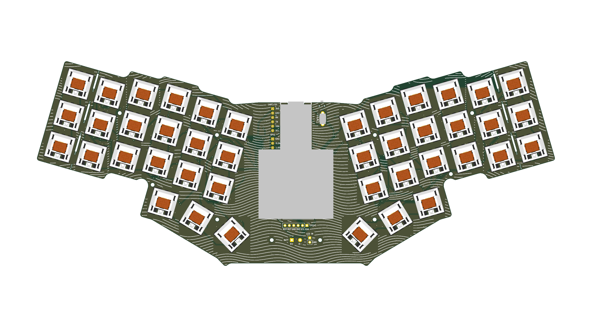

# unicorne

A unibody [Corne](https://github.com/foostan/crkbd): both halves of the Corne v3 key layout on one PCB, each half
rotated 16°, with an Azoteq TPS43 trackpad in the middle and a nice!nano v2 mounted underneath.

Status: layout fixed, schematic done, MX and Choc boards fully routed (DRC: 0 unconnected, 0 copper violations).

## Design

- 42 keys (3×6 + 3 thumbs per half), outer pinky columns break off for a 36-key board
- Key spacing, stagger, thumb cluster and LED positions copied from crkbd `v3-final` (19.0 mm pitch)
- Two board versions with the same placement: Kailh MX hotswap, and Kailh Choc hotswap (fits Choc V1 and V2)
- nice!nano v2 on the bottom side, USB on the top edge
- TPS43 trackpad wired to six bare pads (no FPC, to keep it thin)
- Optional LEDs: 12 SK6812MINI underglow + 42 SK6812MINI-E per key, on their own MOSFET-switched supply.
  A solder jumper picks the source: the nice!nano's 3.3 V VCC (up to its 1 A regulator), or an external
  supply up to 5 V on the LED IN pads for full brightness. Never the battery.
- MSK-12C02 battery cut-off switch, through-hole battery pads
- Exposed pads: expansion header (3V3, GND, UART, I2C) and GPIO header (P0.24, P1.00, P0.11)

The full pin plan and parts list are in `mock/index.html` (open it in a browser).

## Parts list

Everything is hand-soldered. Quantities are for one board; the 36-key build needs 36 of each per-key part.

### On the PCB

| Ref | Qty | Part | Footprint | Notes |
|---|---|---|---|---|
| U1 | 1 | nice!nano v2 | through-hole, bottom side | Needs the 3 inner pads (P1.01, P1.02, P1.07) too; use low-profile sockets or solder directly |
| SW1–42 | 42 | Key switches: MX, or Choc V1/V2 | hotswap | MX on `unicorne.kicad_pcb`, Choc on `unicorne-choc.kicad_pcb` |
| — | 42 | Hotswap sockets: Kailh MX, or Kailh Choc | SMD, bottom | The Choc socket fits both V1 and V2 switches |
| D1–42 | 42 | 1N4148W diode | SOD-123, bottom | |
| SW43 | 1 | MSK-12C02 slide switch | SMD, bottom, top edge | Battery cut-off |
| SW44 | 1 | 6×6×5 mm tactile switch | through-hole | Reset |
| J1 | — | Battery B+ / B− pads | through-hole, 4.8 mm | Solder the battery leads here |
| J2 | — | TPS43 pads | through-hole, 2.54 mm | Wires to the trackpad (trackpad build) |
| J5 | — | Sensor pads | through-hole, 2.54 mm | Wires to a PAW3395 / PMW3360 board (sensor build) |
| J3 | 1 | 1×6 pin header, 2.54 mm | through-hole | Optional: expansion (3V3, GND, UART, I2C) |
| J4 | 1 | 1×4 pin header, 2.54 mm | through-hole | Optional: GPIO (P0.24, P1.00, P0.11) |
| R3, R4 | 2 | 4.7 kΩ resistor | 0805 hand-solder | Trackpad build only (I2C pull-ups); leave off with a sensor |
| R5 | 1 | 10 kΩ resistor | 0805 hand-solder | Trackpad / sensor reset pull-up |

### Optional LEDs

Leave all of these off for a board without lighting.

| Ref | Qty | Part | Footprint | Notes |
|---|---|---|---|---|
| LED1–12 | 12 | SK6812MINI | 3.5 mm PLCC4, bottom | Underglow |
| LED13–54 | 42 | SK6812MINI-E | reverse mount, bottom | Per-key; shines up through a cutout |
| JP2 | — | 3-pad solder jumper | — | LED source: bridge VCC–centre, or EXT–centre for J6 |
| J6 | — | LED IN pads (V+, GND) | through-hole, 2.54 mm | External LED supply up to 5 V, e.g. a USB-C breakout; only with JP2 on EXT |
| Q1 | 1 | AO3401A P-MOSFET | SOT-23 | Switches the LED supply |
| Q2 | 1 | 2N7002 N-MOSFET | SOT-23 | Driven by P1.00 |
| R1, R2 | 2 | 100 kΩ resistor | 0805 hand-solder | Keep the LEDs off during boot |
| C1 | 1 | 10 µF capacitor | 0805 hand-solder | LED supply |
| U2 | 1 | SN74LV1T125 buffer | SOT-23-5 hand-solder | LED data level shifter, needed only with JP2 on EXT; must be the LV1T (not 74LVC1G125) so 3.3 V data works at 5 V |
| C2 | 1 | 100 nF capacitor | 0805 hand-solder | U2 decoupling; leave off with U2 |
| JP3 | — | Solder jumper | — | U2 bypass: bridge it with JP2 on VCC and U2 left off |
| JP1 | — | Solder jumper | — | Bridge it to send LED data from P0.06 (through U2) |

### Off the PCB

| Qty | Part | Notes |
|---|---|---|
| 1 | Azoteq TPS43 trackpad (43.3 × 40.3 mm) | Trackpad build; or a PAW3395 / PMW3360 sensor board for a trackball (3.3 V supply) |
| 1 | 3.7 V LiPo battery | Sits under the trackpad on the bottom; size it to your case |
| 42 | Keycaps, MX or Choc | 40 × 1u and 2 × 1.5u (the big thumb key on each half) |
| 10 | M2 button-head screws (ISO 7380) + standoffs | Mounting holes H1–H10; standoff height depends on the case |

## Ordering (JLCPCB)

Upload `export/jlcpcb/unicorne-mx-jlcpcb.zip` or `unicorne-choc-jlcpcb.zip` (gerbers plus Excellon drills,
plated and non-plated separate). Settings:

| Option | Value |
|---|---|
| Layers | 2 |
| Thickness | 1.6 mm |
| Size | about 300 × 119 mm (read from the outline) |
| Min. via / hole | 0.3 mm via drill, 0.5 mm mouse-bite holes |
| Min. track / spacing | 0.2 mm / 0.2 mm (0.15 mm rule minimum) |
| Surface finish | HASL (lead-free if you prefer) |
| Everything else | defaults |

No assembly: every part is hand-soldered (see the parts list). Regenerate the zips with
`python3 tools/export_gerbers.py` after any board change; it refuses to export a board that fails DRC.

## 3D

`export/unicorne-mx.step` and `export/unicorne-choc.step` are the full boards with parts, for designing a
case (rendered previews next to them). Sockets and the Choc V1 switch are real models; the nice!nano, TPS43,
MX switch, SK6812MINI and MSK-12C02 are size-accurate placeholder boxes from `tools/step_box.py`.
Regenerate with `python3 tools/export_3d.py` after any board change.



## Files

| Path | Contents |
|---|---|
| `unicorne.kicad_pro` | KiCad 10 project |
| `unicorne.kicad_sch`, `matrix.kicad_sch`, `leds.kicad_sch` | Schematic (generated, see below) |
| `unicorne.kicad_pcb` | MX hotswap PCB (generated, see below) |
| `unicorne-choc.kicad_pcb`, `unicorne-choc.kicad_pro` | Choc V1/V2 hotswap PCB, same placement |
| `unicorne.kicad_dru` | Extra DRC rules (LED cutout edge clearance) |
| `lib/` | Project symbols and footprints; third-party credits in `lib/ATTRIBUTION.md` |
| `tools/layout.py` | Key, trackpad and outline geometry → `mock/layout.json`, `mock/unicorne.svg` |
| `tools/gen_schematic.py` | Generates the schematic sheets from `mock/layout.json` |
| `tools/gen_pcb.py` | Builds both PCBs from the schematic netlist and `mock/layout.json` |
| `tools/finish_route.py` | Routes a freshly generated board: fixed lanes, then KiCad's ratsnest with the maze router, GND pours and stitching |
| `tools/lanes.py`, `tools/maze_route.py` | Fixed routing lanes for the key grid; the grid A* router |
| `tools/route.py` | Freerouting driver (not used for the final boards) |
| `tools/step_box.py`, `lib/3d/` | Placeholder STEP models and the socket / Choc switch models |
| `tools/export_3d.py`, `export/` | STEP export of both boards, and 3D renders |
| `tools/export_gerbers.py`, `export/jlcpcb/` | JLCPCB gerber + drill zips |
| `mock/` | Layout data, a 1:1 printable SVG and the design overview page |

## Regenerating

```sh
# Geometry (needs KiCad's bundled Python for the outline)
/Applications/KiCad/KiCad.app/Contents/Frameworks/Python.framework/Versions/Current/bin/python3 tools/layout.py

# Schematic (overwrites the three .kicad_sch files)
python3 tools/gen_schematic.py

# PCBs (overwrite the board files; placement, outline, holes, silkscreen, no tracks)
# then route them; both steps throw away any hand routing
/Applications/KiCad/KiCad.app/Contents/Frameworks/Python.framework/Versions/Current/bin/python3 tools/gen_pcb.py mx
/Applications/KiCad/KiCad.app/Contents/Frameworks/Python.framework/Versions/Current/bin/python3 tools/gen_pcb.py choc
/Applications/KiCad/KiCad.app/Contents/Frameworks/Python.framework/Versions/Current/bin/python3 tools/finish_route.py mx
/Applications/KiCad/KiCad.app/Contents/Frameworks/Python.framework/Versions/Current/bin/python3 tools/finish_route.py choc
```

## Licenses

The nice!nano footprint comes from [bstiq/nice-nano-kicad](https://github.com/bstiq/nice-nano-kicad) under GPLv3;
the hotswap footprints from [keyswitch-kicad-library](https://github.com/joe-scotto/keyswitch-kicad-library) under MIT.
